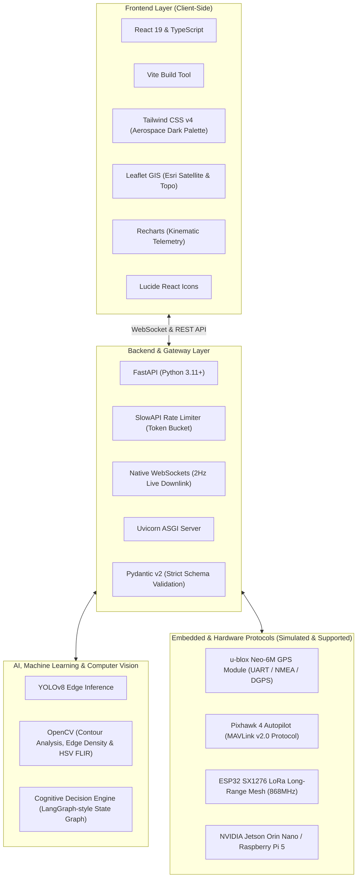

# GeoForge AI — Minimum Viable Product (MVP) & Technology Stack Specification

---

## 1. 📋 Executive Summary & Elevator Pitch

**GeoForge AI** is an intelligent, autonomous aerial surveillance and terrain monitoring platform engineered for extreme, inaccessible, and hostile geographies (mountain passes, glacial gorges, landslide-prone escarpments, and border/forest reserves). 

By uniting **GPS-enabled drone telemetry**, **edge computer vision (YOLOv8 & OpenCV)**, and an **autonomous Agentic AI cognitive engine**, GeoForge AI shifts aerial monitoring from passive video streaming to proactive, automated decision-making — detecting life-threatening hazards, stranded victims, and wildfire hot-spots in real time with explainable reasoning.

---

## 2. 🎯 Problem Statement & Target Domain

Traditional drone surveillance in challenging mountainous terrains suffers from severe bottlenecks:
- **Pilot Fatigue & Cognitive Overload**: Constant manual monitoring of video feeds leads to missed hazards and delayed reactions.
- **Latency & Signal Dropouts in Remote Regions**: Poor terrestrial connectivity hinders cloud-dependent video processing; systems require edge-native autonomy.
- **Dynamic Terrain Hazards**: Hilly terrains present sudden rockfalls, steep slope shear, turbulent ridge downdrafts, and extreme thermal contrasts that human operators cannot calculate quickly in real time.
- **Lack of Decision Support**: Existing platforms display raw telemetry (altitude, battery, GPS) without situational intelligence or automated safety rerouting.

---

## 3. 💡 The GeoForge AI Solution

GeoForge AI provides an end-to-end autonomous command and control dashboard backed by a local cognitive agent that:
1. **Perceives**: Ingests multi-spectral aerial video feeds (RGB, Thermal FLIR, Topo Contours) and telemetry downlinks (Neo-6M GPS, Pixhawk IMU, LiPo battery, weather sensors).
2. **Evaluates**: Employs an on-edge YOLOv8 inference model to spot stranded humans, active landslide fissures, wildfire smoke plumes, and unauthorized entities.
3. **Decides**: Executes an autonomous 4-node cognitive reasoning loop (Perception ➔ Risk Assessment ➔ Action Planning ➔ Safety Validation) that can self-authorize failsafe protocols (emergency standoff loiter, automated Return-to-Launch, or search-and-rescue beacon deployment).
4. **Collaborates**: Offers a real-time, explainable AI Mission Co-Pilot that pilots can converse with via natural language to query risk indices, weather envelopes, and battery margins.

---

## 4. 🚀 MVP Scope & Core Delivered Capabilities

| Feature Module | What the MVP Delivers |
| :--- | :--- |
| **Tactical Flight HUD** | Real-time artificial horizon (pitch & roll), altitude (AGL/MSL), groundspeed, heading compass, 6S LiPo battery state-of-charge, and ultrasonic anemometer wind vector readouts. |
| **Computer Vision Engine** | Real-time aerial video streaming with dynamic target tracking at 28.5 FPS; multi-spectral view switcher (**RGB Optical**, **Thermal FLIR**, and **Contour Wireframe**); interactive ML inference testing lab for custom aerial imagery uploads. |
| **Agentic AI Cognitive Core** | Explainable decision log with step-by-step reasoning traces (`PerceptionNode`, `TerrainRiskAssessor`, `ActionPlanner`, `SafetyValidator`), automated protocol triggers, and risk score indexing (0–100). |
| **Mission Co-Pilot Chat** | Telemetry-grounded natural language chat assistant providing actionable recommendations with pilot confirmation prompts. |
| **Interactive Tactical GIS Map** | Zero-watermark Leaflet map supporting **Satellite Photorealism**, **Topographical Contours**, and **OpenStreetMap** with breadcrumb trails, geofence polygons, and active hazard pins. |
| **Terrain Threat Alerts System** | Categorized alerts (Critical, Warning, Info) with GPS coordinates, acknowledge/resolve actions, and synthetic Web Audio sirens. |
| **Embedded Subsystems Health** | Real-time diagnostic monitors for u-blox Neo-6M GPS (UART), Pixhawk 4 Autopilot (MAVLink v2.0), ESP32 LoRa Relay, and Jetson/RPi Edge AI compute. |
| **Responsive Mobile Layout** | Touch-friendly mobile interface with a dedicated bottom navigation bar for friction-free monitoring on tablets and smartphones. |

---

## 5. 🛠️ Technology Stack Breakdown

### Detailed Layer Justification:

#### 1. Frontend Layer
- **React 19 + TypeScript**: Guarantees strict compile-time type safety for complex telemetry frames and high 60 FPS UI rendering without dropped frames.
- **Vite 8**: Sub-second hot module reloading (HMR) and optimized rollup production bundles.
- **Tailwind CSS v4**: Hardware-accelerated tactical styling (obsidian slate `#080C14`, tactical cyan `#06B6D4`, crimson alert `#EF4444`) with zero UI latency.
- **Leaflet & Esri GIS**: Completely open, free, un-watermarked high-resolution satellite imagery and topographical mountain contour mapping.
- **Recharts**: Smooth SVG-based rendering of historical altitude profiles, groundspeeds, and battery discharge curves.

#### 2. Backend & Communication Gateway Layer
- **FastAPI**: Asynchronous Python ASGI framework delivering microsecond request turnaround and automatic OpenAPI (Swagger) documentation.
- **WebSockets**: 2 Hz continuous telemetry broadcast channel ensuring sub-50ms synchronization between drone sensors and the dashboard.
- **SlowAPI**: Token-bucket rate limiting middleware (120 req/min for general polling; 30 req/min for heavy vision analysis) to prevent edge server denial-of-service.
- **Pydantic v2**: Type enforcement and serialization for telemetry data, detection bounding boxes, and flight commands.

#### 3. AI, Computer Vision & Edge Intelligence Layer
- **YOLOv8s**: Lightweight convolutional neural network architecture tailored for small-object aerial detection (human silhouettes in snow, vehicle silhouettes, fire smoke).
- **OpenCV (Headless)**: Image processing suite utilized for Canny edge density (cliff fissures), HSV thresholding (thermal hotspots), and real-time procedural MJPEG frame generation.
- **Agentic Decision Graph**: Multi-step cognitive loop implementing autonomous perception, environmental risk scoring, safety bounds checking, and flight mitigation planning.

#### 4. Embedded Hardware & Telemetry Protocols
- **u-blox Neo-6M GPS**: Industry-standard satellite positioning module with 3D DGPS lock and sub-meter HDOP accuracy.
- **Pixhawk 4 & MAVLink v2.0**: De-facto open-source UAV autopilot communication protocol handling waypoint sequencing and failsafe triggers (RTL, Loiter).
- **ESP32 & LoRa (868MHz)**: Low-power, ultra-long-range RF telemetry bridge enabling non-line-of-sight signal transmission across rugged ridges.
- **NVIDIA Jetson Orin Nano / Raspberry Pi 5**: Low-power onboard computers for local real-time inference without cloud dependency.

#### 5. DevOps & Cloud Infrastructure
- **Docker & Docker Compose**: Multi-container containerization for both backend and frontend layers.
- **Render / Railway / Nixpacks**: Zero-configuration cloud deployment pipelines utilizing `render.yaml` and `Procfile`.
- **Git & GitHub**: Version-controlled open-source repository management under `OmmRout/GeoForge-AI`.

---

## 6. 💼 Startup & Major Project Viability

| Evaluation Parameter | How GeoForge AI Meets It |
| :--- | :--- |
| **Commercial Potential** | Applicable to National Disaster Response Forces (NDRF), Forest Fire Departments, Border Security, and Mountain Search & Rescue operations. |
| **Technical Rigor** | Combines Embedded Systems, Robotics Telemetry (MAVLink), Edge AI (YOLOv8), Asynchronous Web Architectures, and Modern Agentic AI. |
| **Operational Feasibility** | The system runs completely standalone on modest edge hardware with no mandatory third-party subscription fees or paid API keys. |
