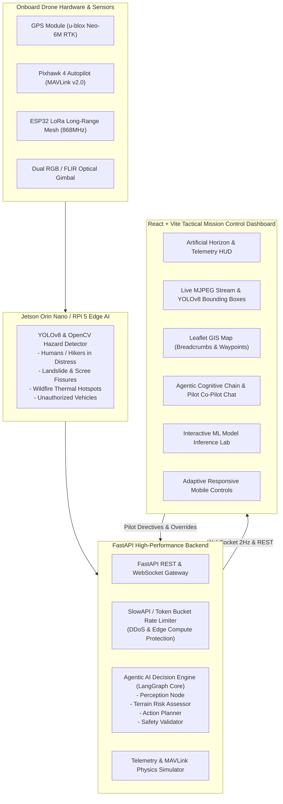

# GeoForge AI — Autonomous Drone Surveillance System for Challenging Terrains

[](https://opensource.org/licenses/MIT)
[](https://fastapi.tiangolo.com)
[](https://react.dev)
[](https://tailwindcss.com)
[](https://ultralytics.com)
[](https://github.com/langchain-ai/langgraph)
[](https://render.com/deploy?repo=https://github.com/OmmRout/GeoForge-AI)

**GeoForge AI** is an Agentic AI-powered autonomous drone monitoring platform engineered for extreme, remote, and challenging topography (mountainous ridges, glaciated valleys, border sectors, and landslide/wildfire zones). 

The platform bridges edge computing, Pixhawk autopilot MAVLink telemetry, GPS Neo-6M positioning, and real-time computer vision inference with an autonomous multi-step reasoning agent.

---

## 🛰️ Architecture & Cognitive Flow



---

## 📁 Modern Enterprise Folder Structure

```text
MCA MAJOR PROJ/
├── backend/
│   ├── app/
│   │   ├── api/
│   │   │   └── v1/
│   │   │       ├── endpoints/
│   │   │       │   ├── agent.py         # Cognitive decisions & Pilot Chat
│   │   │       │   ├── alerts.py        # Terrain alerts & triage actions
│   │   │       │   ├── drones.py        # Fleet status & flight commands (RTL, Loiter)
│   │   │       │   ├── system.py        # Hardware health diagnostics
│   │   │       │   ├── telemetry.py     # Real-time GPS & IMU downlink
│   │   │       │   └── vision.py        # MJPEG live stream & image inference
│   │   │       └── api_router.py        # Unified v1 router bundle
│   │   ├── core/
│   │   │   ├── config.py                # Environment & threshold settings
│   │   │   ├── rate_limiter.py          # SlowAPI & Token bucket rate limiting
│   │   │   └── websocket_manager.py     # Low-latency broadcast manager
│   │   ├── ml/
│   │   │   └── cv_detector.py           # YOLOv8 & OpenCV computer vision engine
│   │   ├── models/
│   │   │   ├── agent.py                 # Decision & reasoning schemas
│   │   │   ├── alert.py                 # Alert priority schemas
│   │   │   ├── detection.py             # Bounding boxes & class labels
│   │   │   └── drone.py                 # Telemetry & flight mode schemas
│   │   ├── services/
│   │   │   ├── agentic_engine.py        # Multi-node cognitive reasoning engine
│   │   │   ├── alert_service.py         # Alert management & deduplication
│   │   │   └── telemetry_simulator.py   # MAVLink & drone physics engine
│   │   └── main.py                      # FastAPI lifespan, CORS, rate limiting & WS
│   ├── Dockerfile
│   ├── requirements.txt
│   └── run.py
│
├── frontend/
│   ├── src/
│   │   ├── components/
│   │   │   ├── AgenticPanel.tsx         # Real-time agent decision timeline & explainability
│   │   │   ├── AlertsDrawer.tsx         # Tactical alerts slide-over manager
│   │   │   ├── AnalyticsView.tsx        # Altitude, speed & battery Recharts
│   │   │   ├── CopilotChat.tsx          # Natural language AI Co-Pilot chat
│   │   │   ├── HardwareStatus.tsx       # Embedded subsystem telemetry cards
│   │   │   ├── Header.tsx               # Tactical brand, status pills & emergency RTL
│   │   │   ├── MLTestingModal.tsx       # Interactive YOLOv8 image inference lab
│   │   │   ├── MobileNav.tsx            # Smooth bottom navigation for mobile view
│   │   │   ├── TacticalMap.tsx          # Leaflet GPS map with trail & waypoints
│   │   │   ├── TelemetryHUD.tsx         # Artificial horizon & flight instrumentation
│   │   │   └── VideoFeed.tsx            # Live aerial video stream with dynamic tags
│   │   ├── hooks/
│   │   │   ├── useAlerts.ts             # Alert subscription & audio triggers
│   │   │   └── useDroneTelemetry.ts     # WebSocket telemetry with fallback polling
│   │   ├── types/
│   │   │   └── index.ts                 # Full TypeScript definitions
│   │   ├── utils/
│   │   │   └── formatters.ts            # Coordinates, time-ago & Web Audio synthesizer
│   │   ├── App.tsx                      # Zero-lag responsive dashboard layout
│   │   ├── main.tsx                     # React 19 root mounting
│   │   └── style.css                    # Tactical dark theme & animations
│   ├── Dockerfile
│   ├── package.json
│   ├── tsconfig.json
│   └── vite.config.ts                   # Vite proxy configuration
│
├── docker-compose.yml
├── start.bat                            # 1-Click Windows Batch launcher
├── start.ps1                            # 1-Click Windows PowerShell launcher
└── README.md
```

---

## ⚡ Key Highlights & Features

1. **Agentic AI Cognitive Core**:
   - Implements a transparent 4-stage cognitive loop: `PerceptionNode` ➔ `TerrainRiskAssessor` ➔ `ActionPlanner` ➔ `SafetyValidator`.
   - Autonomous protocol evaluation (e.g. "Low battery + 40km/h crosswind -> Auto-reroute to Emergency Landing Zone Bravo").
   - Natural language Mission Co-pilot with telemetry grounding.

2. **Computer Vision & ML Demo Pipeline**:
   - Simulated YOLOv8 inference streaming at 28.5 FPS.
   - Detects stranded humans, active landslide fractures, wildfire thermal hotspots, and unauthorized vehicles.
   - Interactive **ML Testing Lab**: Upload custom aerial imagery or pick from pre-baked mountain scenarios to test OpenCV contour & feature extraction.
   - Multi-spectral modes: **RGB Optical Cam**, **Thermal FLIR**, and **Terrain Contour Wireframe**.

3. **Telemetry & Embedded Hardware Diagnostics**:
   - **u-blox Neo-6M GPS**: 16 satellites, HDOP 0.72, 3D DGPS fix.
   - **Pixhawk 4**: MAVLink v2.0 heartbeat at 4.0 Hz.
   - **ESP32 LoRa**: 868MHz Mesh repeater monitoring.
   - **Jetson Orin Nano / RPi 5**: Real-time FPS, temperature, and load diagnostics.

4. **Production Safeguards & Rate Limiting**:
   - Integrated **SlowAPI** rate limiting middleware to prevent API flooding and protect edge compute resources (`120/min` on standard endpoints, `30/min` on heavy ML inference).
   - Dual-layer telemetry downlink: Real-time WebSocket (`/ws/telemetry`) with seamless automatic failover to background HTTP polling.

5. **Responsive & Mobile-Ready**:
   - Designed with high-performance CSS and zero-lag layouts.
   - Dedicated mobile bottom navigation bar with specialized views (`Command`, `Drone Cam`, `GPS Map`, `Agent AI`, `Analytics`).
   - Sleek aerospace dark color palette (Obsidian slate `#080C14`, Tactical Cyan `#06B6D4`, Alert Rose `#EF4444`, Emerald `#10B981`).

---

## 🚀 Quick Start Guide

### Option 1: 1-Click Launch (Windows)
Double-click `start.bat` or run:
```powershell
.\start.ps1
```

### Option 2: Manual Setup

#### 1. Start Backend:
```bash
cd backend
python -m pip install -r requirements.txt
python run.py
```
Backend will be live at `http://localhost:8000` (Swagger docs at `/docs`).

#### 2. Start Frontend:
```bash
cd frontend
npm install
npm run dev
```
Frontend dashboard will be accessible at `http://localhost:5173`.

### Option 3: Docker Compose
```bash
docker-compose up --build
```
